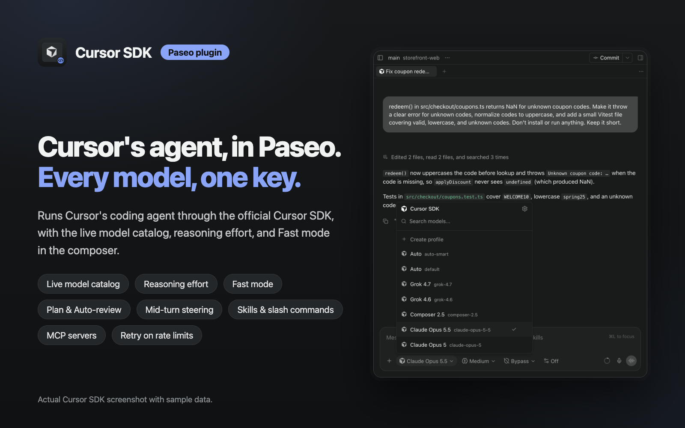

# Cursor SDK



Community Paseo provider that runs the Cursor coding agent through the official
`@cursor/sdk` (local runtime, SQLite store) instead of the `cursor-agent` ACP binary.
It registers provider id `cursor-sdk` ("Cursor SDK", `server/provider.ts:203`).
The registry listing page is [`OVERVIEW.md`](OVERVIEW.md).

## Requirements

- Paseo `>=0.11.0` (see `requirements` in `paseo-plugin.json`). 0.11.0 is the first
  release that reads the listing metadata (`name`, `icon`, `media`); the plugin
  typechecks against the `@getpaseo/plugin` 0.10.3 SDK.
- Node `>=22.13` on the daemon host. On macOS, Paseo Desktop uses a standalone
  Node executable for Cursor sessions so Cursor's native parser can load.
  The worker uses `node` on the daemon's PATH or the executable specified by
  `CURSOR_PROVIDER_NODE` in the daemon environment.
- Git installs run `npm ci --omit=dev --ignore-scripts` and build the worker
  through the plugin manifest. Paseo compiles the client and server entries on load.

## Setup

### 1. Install

```bash
npm run typecheck
paseo plugin install /absolute/path/to/cursor-sdk
paseo plugin ls   # expect `running`
```

For directory installs, run `npm install` and `npm run build:worker` in the
plugin directory first.

### 2. API key

The SDK needs a user or service-account API key. **CLI login does not transfer.**
Mint one at [cursor.com/dashboard/api](https://cursor.com/dashboard/api) — usage bills
to your plan like IDE usage.

Key sources, in precedence order (`server/provider.ts:276`):

| Priority | Source | How |
| --- | --- | --- |
| 1 | Per-agent env | `CURSOR_API_KEY` in the agent's env (e.g. `--env`) — wins for that session |
| 2 | Settings UI | Cursor settings screen (host-scoped plugin settings) |
| 3 | Daemon env | `CURSOR_API_KEY` exported on the daemon process |
| 4 | Sign in | **Sign in with Cursor** in the settings screen; the SDK stores the key in `~/.cursor/sdk/auth.json` and falls back to it |

The settings screen has a **Check key** action that calls the `cursor.validate-key`
RPC: a key-only `Cursor.models.list` catalog check that spends nothing. Otherwise the
key is validated on next session open. Without any key, sessions fail with
`Set CURSOR_API_KEY to use the Cursor provider` and the model catalog falls back to
a single `composer-2.5` entry.

### 3. Local state

Sessions persist in the SDK's SQLite store (`@cursor/sdk/sqlite`, backed by
`node:sqlite`), one state root per workspace under
`~/.cursor/sdk/paseo-plugin/sqlite/<sha256(cwd)>` (`server/local-store.ts`).
Override the base with `CURSOR_SDK_STATE_ROOT` (per-agent env or daemon env).

Don't switch to the SDK's `JsonlLocalAgentStore`. It re-reads, re-parses and
rewrites a whole NDJSON file on every operation; with every agent sharing one
store, each checkpoint write cost about 1 GB of transient heap, and the plugin
process ran out of memory within minutes to hours. Versions before a5c3ffa used
it; agents from that store are not read anymore.

A run the store still marks active after the plugin process died (crash,
reload) is cancelled on the next resume, so the agent does not fail with
`Agent … already has active run`.

### 4. Diagnostics

The SDK discards its own retry logging for local runs, and `run.wait()` keeps only
`{message, code}`. `server/diagnostics.ts` records the rest from outside the SDK:

- **SDK spans.** It registers a tracer on the OpenTelemetry global, which the SDK's
  bundled API reads. That captures every internal attempt (`agent.request.attempt`),
  each RPC failure with its full error chain (`rpc.run`), and the transcript rewrites
  (`writeFromState`, `hydrate*`).
- **HTTP/2.** It wraps `http2.connect`, so every Cursor stream is recorded: reset code,
  who closed it, time since the last byte, GOAWAY frames, and ping timeouts.
- **`node:sqlite`.** It times statements, because every store write is synchronous on
  the plugin's main thread.
- **Event-loop stalls and GC pauses.** Each stall records the SQLite time, spans, and
  GC that overlapped it.

Records go to `~/.cursor/sdk/paseo-plugin/diagnostics/cursor-diag-YYYY-MM-DD.jsonl`
(local date), one JSON object per line, with a 64 MB cap per day and 14 days of
retention. Change the directory with `CURSOR_PROVIDER_DIAGNOSTICS_DIR`, or turn
diagnostics off with `CURSOR_PROVIDER_DIAGNOSTICS=0`. Failed or flagged turns, and
transport trouble, also print one `cursor-sdk diag:` line to the daemon log. Prompts,
output, and headers other than request ids are never recorded.

Each turn writes one `kind: "turn"` record. Its main fields:

- `flags`: `no_progress`, `multiple_turn_ended` (the SDK resumed after the answer),
  `error_after_answer`, `sdk_retry`, `plugin_retry`, `stream_reset_by_peer`,
  `stream_lost_with_session`, `stream_cancelled_by_client`, `http2_goaway`,
  `http2_session_error`, `loop_stall_1s`/`loop_stall_5s`, `sdk_span_errors`, and
  `cancel:<reason>`.
- `attempts`: one entry per SDK HTTP/2 attempt, joined by `x-original-request-id`.
- `sdk.timeline`: the attempt, RPC, and slow spans, with errors.
- `process`: process-wide context, shared with other agents, so not proof of cause.
- `storeBytes`: store sizes, only on turns that ended badly.

Other kinds: `loop_stall`, `sqlite_slow`, `http2_goaway`, `http2_session_error`,
`http2_ping_failed`, `http2_slow_ping`, `http2_session_close`, `http2_stream`
(abnormal non-agent streams), and `process`, a 5-minute heartbeat with memory, GC,
top SQL, and top spans.

```sh
D=~/.cursor/sdk/paseo-plugin/diagnostics
# Bad turns today
jq -c 'select(.kind=="turn" and (.status=="failed" or (.flags|length>0))) | {ts,agentId,status,flags,error,sdkAttempts}' $D/cursor-diag-$(date +%F).jsonl
# How each attempt of one turn ended
jq -c 'select(.turnId=="turn-…") | .attempts[] | {startMs,ms,rst,closedBy,silentMs,error}' $D/*.jsonl
# Worst main-thread stalls
jq -cs 'map(select(.kind=="loop_stall")) | sort_by(-.ms) | .[:10][] | {at,ms,sqliteMs,gcMs,slowestSql,spansEnded}' $D/*.jsonl
```

## What works

- Text and image prompts (`prompt.message`, `prompt.image`).
- Mid-turn steering (`prompt.steer`, via `run.steer`).
- Slash commands (`prompt.command`): Cursor skills and command files from the
  session cwd and the home directory (`.cursor`, `.claude`, `.codex`, `.grok`,
  `.agents`, plus installed `~/.cursor/plugins`), with `/plan`, `/compact`,
  `/review`, and `/commit` filling any names that are not already taken.
- `agent` / `plan` modes, switchable mid-session; model switch applies on next prompt.
- Live model catalog via `Cursor.models.list` (single `composer-2.5` fallback when
  keyless or the list call fails).
- Per-model reasoning effort: the thinking dropdown lists the model's effort
  values (`low`/`medium`/`high`/`xhigh`/`max`, `reasoning` variants, or `On`/`Off`
  for older `thinking` models), defaulting to the model's default variant.
- Fast select (`Off`/`Fast`, lightning icon) on models that expose a `fast`
  parameter; hidden otherwise. Unset follows the model's default variant and
  the control shows that default. Permission level is the mode (see below).
- MCP servers (stdio + http/sse) passed through to the SDK.
- Session persistence / listing / configure; usage reporting
  (input, cached-input, output tokens).
- Subagents are Paseo agents. When the daemon gives the session its `paseo`
  MCP server (Paseo tools on, the default), Cursor's `task` tool is disabled
  (`disallowedTools: ["task"]`, re-passed on every resume), so the model
  delegates through Paseo's `create_agent` tool, found from its description
  as with every other provider. These run in parallel with the parent, show
  up in Paseo, and take follow-ups.
- Without the `paseo` server, Cursor's own `task` subagents run as
  provider-owned child sessions (`restoration: "parent"`). Their text,
  reasoning and tool calls stream into the child through the `send` option
  `onDelta`; `run.stream()` only carries the parent's `task` card.
- Transient-failure retry: rate-limit / quota, model capacity (`resource_exhausted`,
  429 family), and network (5xx / timeout / unavailable) errors retry up to 3 total attempts with
  1s → 15s capped exponential backoff and a visible warning notice per retry
  (`server/retry.ts`). Known codes are also recovered from message prefixes such
  as `[resource_exhausted]` when the SDK omits the structured code.
  Auth/config errors (401/400/404), `agent_busy` (409),
  and cancellations never retry.
- Conversation revert (`session.revert.conversation`) and archive/unarchive — with
  the limits below.

## Limitations

- **Revert is conversation-only.** `files` / `both` scopes throw
  (`Cursor provider supports conversation revert only`). The SDK store is
  append-only with no rewind API, so conversation revert closes the live runtime,
  starts a fresh native agent, and the daemon replays the surviving prefix from its
  own timeline.
- **Archive/unarchive are local-runtime operations.** Archive closes the live
  runtime and drops provider-owned children; the durable SQLite record stays
  resumable via `Agent.resume`. Unarchive is a no-op validation. The SDK's
  **cloud-only `Agent.archive` / `Agent.unarchive` / `Agent.delete` statics are
  unused** — nothing is ever deleted server-side by this provider.
- **Node `>=22.13`** is required by `@cursor/sdk`, even though the daemon compiles
  the server bundle for an older Node target.
- **Slash menu is the on-disk catalog, not Cursor's cloud commands.** The SDK
  exposes no command listing. The provider scans the same local skill and
  command files cursor-agent does (`server/cursor-commands.ts`) and publishes
  them on `session.commands`. Team/dashboard commands are not included. Paseo
  shows that list when `/` is the first character of the composer. A `/` typed
  later in the draft only lists entries the daemon tagged `kind: "skill"`, and
  the plugin bridge currently tags every plugin command as `kind: "command"`,
  so inline `/` stays empty until Paseo passes that kind through.
- **`/compact` runs `agent.summarize()`** (SDK ≥ 1.4, the CLI's `/summarize`).
  From the slash menu or typed as the whole message, it starts a summarize run
  instead of a send; later sends see the summary instead of the transcript.
  The run's `summary` stream messages drive Paseo's compaction row (`manual`;
  Cursor's own summaries near the context limit show as `auto`). `error`
  shows "the conversation is unchanged", and `fallback: true` warns that a
  trimmed transcript was saved instead. The SDK refuses (`ConfigurationError`,
  not retried) on an agent with no saved conversation yet.
- **Only long reconnects are visible.** The SDK's `onConnectionStateChange`
  (SDK ≥ 1.4, passed on create and resume) reports transport retries. Paseo
  appends every notification and can't remove one, so a reconnect that
  succeeds within 20s posts nothing; a longer stall posts one "still
  reconnecting" warning. Each state lands in the turn diagnostics as a
  `connection` note with `attempt`, `errorClass` and `stallAborted`.
- **Permission level is the mode, like Claude and Codex.** Local SDK runs have
  no approval channel, so the provider never raises a permission. The stream's
  `request` event only announces the run's request id and is not shown.
  - **Bypass** (default, `ShieldOff`, unattended): `autoReview: false`; every
    tool call runs.
  - **Auto-review** (`ShieldCheck`): `autoReview: true`; Cursor's Smart Auto
    Review classifier vets each call, and a call it would ask about is denied
    ("Local SDK runs cannot request interactive approval…").
  - **Plan**: read-only SDK plan mode.

  The SDK reads `autoReview` once per runtime, so switching between
  Auto-review and Bypass reopens the agent before the next prompt. Sessions
  from before the modes carry `agent` plus the retired Auto Accept toggle
  (`auto_accept` / `autoReview`); toggle on opens as Auto-review, otherwise
  Bypass.
- **Reasoning effort is a value dropdown, fast is a select.** Thinking options
  are the model's effort-param *values* (e.g. `low`…`max`), never parameter
  ids (`effort`, `context`) or other models' values — switching models re-keys
  to the new model's default. `context` (window size) always follows the
  default variant. `fast` is a separate `Off`/`Fast` select (`zap` icon) shown
  only on models that expose it. Unset is not sent, so the backend default
  applies, and the select displays that default (`Off` is the inactive option
  so only an explicit Fast highlights).
- **Context window usage is the checkpoint's `token_details`.** Cursor's public
  run usage is a billed sum across every model call, so it is wrong after
  compaction. The saved conversation checkpoint carries `used_tokens` and
  `max_tokens` (the IDE ring's numbers, including the post-summary size). The
  indicator updates when a session opens and when a turn ends. Between those,
  each `model-call-completed` delta (SDK ≥ 1.4) moves it to that call's
  `inputTokens + outputTokens`, which equals the next checkpoint's
  `used_tokens` (`inputTokens` already includes cache reads and writes), so a
  long turn and an in-turn summary show live. A conversation that never
  checkpointed has no figure.
- History replay on resume is best-effort (last ~20 messages) and never blocks
  session open.
- **Cursor `task` subagents (fallback only) block their parent and can't be
  prompted.** The tool is synchronous and takes no background flag, and the
  SDK has no handle for messaging a running subagent, so that child session is
  read-only. This is why Paseo agents replace it by default.
- **`systemPrompt` replaces Cursor's whole harness prompt** (SDK
  `AgentOptions.systemPrompt`, server-gated).

## Parity vs the built-in `cursor` provider

The built-in provider shells out to `cursor-agent acp`
(`cursor-agent`, ACP transport); this plugin drives `@cursor/sdk` in-process.

| Area | Built-in `cursor` (ACP) | This plugin (`cursor-sdk`) | Status |
| --- | --- | --- | --- |
| Text / image prompts | Yes | Yes | Works |
| `agent` / `plan` modes | Yes | Yes | Works |
| MCP servers | Yes | Yes (stdio + http/sse) | Works |
| Session persistence / listing | Yes | Yes (local SQLite store) | Works |
| Model catalog | Live, per-model `thought_level` thinking options | Live list, per-model effort-value thinking dropdown | Works |
| Fast mode toggle | Yes (`fast` feature) | Yes (`Off`/`Fast` select, only on models with a `fast` param) | Works |
| Slash commands | Dynamic via `available_commands_update` | Local skills + command files, plus helper names that are free | Works, no team commands |
| Tool approval | ACP permission-request flow | Auto-executed; deny cancels run; input questions surfaced | Degraded |
| Revert | None (`supportsRewind*` all false) | Conversation-only (close + fresh agent; `files`/`both` throw) | Works, limited |
| Archive / unarchive | Daemon/ACP session lifecycle | Local close + resume; unarchive no-op; cloud statics unused | Degraded |
| Subagents | ACP-native | `task`-tool calls mapped to provider-owned child sessions | Works |
| Transient retry notices | — | Retry ≤3 attempts, backoff + warning notice | Works (plugin-side) |

## Ship notes

- `package.json` `files` covers `paseo-plugin.json`, `OVERVIEW.md`, `assets/`, both
  entries (`index.client.tsx`, `index.server.ts`), `client/`, `server/`, `shared/`,
  and `icon.svg` — all present. (`README.md`, like `package.json`, ships under npm
  defaults even though it is not listed in `files`.)
- Listing: `name`, `description`, `icon` (`assets/icon.png`), and `media` in
  `paseo-plugin.json`, plus a `zh-CN` name and description. `assets/00-thumbnail.png`
  is the registry card. Screenshots come from a throwaway daemon with a sample
  `storefront-web` repository; retake them when the composer or settings change.
- `paseo-plugin.json` `requirements.paseo: ">=0.11.0"` is a valid semver range.
- `package-lock.json` is committed.
- `private: true` blocks `npm publish`; remove it only if an npm distribution is
  wanted in addition to Git / directory installs.
